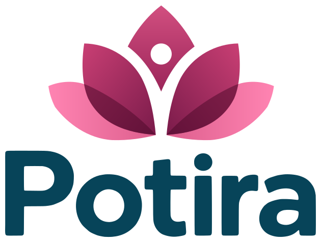

<p align="center">
  
</p>

<p align="center"><b>Registro clínico, agenda e cobrança para profissionais de saúde.</b><br>
Feita no Brasil, em português, com LGPD, PIX e o vocabulário de quem atende.</p>

<p align="center">
  <a href="https://rafajames.github.io/florescer-relatorios/"><b>Abrir a Potira</b></a> ·
  <a href="docs/ATUALIZACOES.md">Novidades</a> ·
  <a href="docs/PENDENCIAS.md">O que falta</a> ·
  <a href="docs/DIRETRIZES.md">Diretrizes</a>
</p>

---

> A Potira nasceu como **Florescer Relatórios**; o repositório e o endereço do site guardam o nome antigo.
> **Potira** é uma palavra de origem tupi que quer dizer **flor**.

**Fase de testes:** em uso com profissionais convidados, sem custo. Roda só em planos gratuitos (GitHub Pages e Supabase).

## O que a Potira faz

| | |
| --- | --- |
| **Início** | Indicadores do mês (pacientes ativos, sessões, receitas, documentos pendentes) com tendência, evolução financeira de receitas e despesas (7, 30 ou 90 dias), ações rápidas, últimas atividades e próximos compromissos. Só dados reais. |
| **Pacientes** | Cadastro, consentimento (LGPD), ficha com resumo, clínico, financeiro e arquivos, metas por paciente e escalas com gráfico. |
| **Agenda** | Lista, semana e mês; sessões que se repetem; bloqueios e encaixes; lista de espera; lembretes pelo WhatsApp com link para o paciente confirmar ou pedir remarcação. |
| **Atendimentos** | Anamnese, evolução de cada sessão e documento livre, digitando ou gravando. A IA (opcional) transcreve e escreve um rascunho; quem revisa e assina é sempre o profissional. |
| **Documentos** | Modelos por área e modelos próprios (inclusive a partir de um Word, PDF ou foto). Exporta em PDF e Word com a logo, as cores e o timbre do profissional. |
| **Financeiro** | Cobrança por sessão, mensalidade ou pacote; PIX copia-e-cola; cobrança agendada; pagamento conferido pelo comprovante (sem guardar o arquivo); gastos; resumo e planilha para o contador; recibos. |
| **Relatórios** | Relatório por período, reunindo as sessões de um paciente. |
| **Paciente** | Portal do paciente (vê só o que foi revisado e liberado), anamnese por link para responder no celular e relatório por link com validade. |

**Privacidade:** cada profissional vê só os próprios pacientes; o áudio das sessões nunca é guardado; consentimento registrado por paciente; trilha de auditoria.

## Visual

- Menu lateral em petróleo, item ativo em rosa, que pode ser recolhido para mostrar só os ícones; no celular, barra inferior com Início, Pacientes, Novo, Agenda e Mais.
- Perfil no canto superior direito (foto do Google quando houver, senão as iniciais) e rodapé com versão e situação da conexão.
- Temas claro, escuro e automático; respeita "reduzir movimento".
- Marca Potira em SVG em [`assets/brand/`](assets/brand/). A marca do profissional (logo e nome) aparece nos documentos; as cores dele também mudam o menu.

## Tecnologia

- **Front-end:** HTML, CSS e JavaScript puro em módulos, **sem framework e sem build**. Publicado pelo GitHub Pages a partir da branch `main`.
- **Banco e login:** [Supabase](https://supabase.com) (PostgreSQL com regras RLS). Todo o acesso fica em `js/api.js`.
- **IA opcional, com a chave do próprio profissional:** Google Gemini (gratuito), Groq (gratuito, inclui transcrição), Anthropic (Claude) e OpenAI. As chaves ficam no navegador daquele computador, nunca no banco. Passo a passo em [`tutoriais/`](tutoriais/).

```
index.html             site
css/                   tokens.css (cores e temas) · app.css (componentes) · marca.css · shell.css (moldura)
                       inicio.css (Início) · landing.css (apresentação)
js/                    main.js (rotas) · ui.js (moldura e janelas) · api.js (banco) · views-*.js (uma tela por arquivo)
assets/brand/          logos, símbolos e ícones da Potira (SVG)
supabase/schema.sql    banco e regras de segurança; pode ser rodado de novo sem risco
tools/stamp.py         carimba a versão (rodar antes de cada commit)
tools/desenhar-marca.py, tools/gerar-marca.py   geram os SVGs da marca e o js/marca-svg.js
preview/               prévias visuais aprovadas (referência de design)
docs/                  documentação do projeto
tutoriais/             como conectar as chaves de IA
local/                 versão antiga de arquivo único; não é mais mantida
```

## Documentação

| Arquivo | Para que serve |
| --- | --- |
| [docs/DIRETRIZES.md](docs/DIRETRIZES.md) | Regras que toda mudança segue (identidade, vocabulário, privacidade, negócio, interface, técnica). **Ler antes de alterar.** |
| [docs/ATUALIZACOES.md](docs/ATUALIZACOES.md) | Histórico do que foi feito, do mais novo para o mais antigo, com o que foi e o que não foi testado. |
| [docs/PENDENCIAS.md](docs/PENDENCIAS.md) | O que falta, o que precisa de conferência e o que aguarda decisão. |
| [docs/CLINICA.md](docs/CLINICA.md) | Desenho da conta de clínica (não implementado). |
| [docs/ESPECIFICACAO-EVOLUCAO-POTIRA.md](docs/ESPECIFICACAO-EVOLUCAO-POTIRA.md) | Plano para autônomos e clínicas, cadastro completo e emissão fiscal (proposta). |
| [docs/CLAUDE-IMPLEMENTAR-REDESIGN-POTIRA.md](docs/CLAUDE-IMPLEMENTAR-REDESIGN-POTIRA.md) | Roteiro do redesign visual. |
| [CLAUDE.md](CLAUDE.md) | Resumo para uma conversa nova com o Claude começar já sabendo o que se espera. |

## Como colocar no ar (outra instalação)

1. Crie um projeto no **Supabase** (região South America, São Paulo).
2. **SQL Editor → New query**: cole `supabase/schema.sql` e rode.
3. **Authentication → Providers → Email**: deixe **Confirm email** ligado (garante que o paciente é dono do e-mail).
4. **Authentication → URL Configuration**: em *Site URL* e *Redirect URLs*, o endereço do site.
5. **Project Settings → API**: copie a *Project URL* e a chave *anon public* para `js/config.js`. A chave `anon` é pública por desenho; quem protege os dados são as regras RLS. **Nunca** coloque a `service_role` no site.
6. **GitHub → Settings → Pages**: *Deploy from a branch*, `main`, pasta `/ (root)`.

## Como contribuir com mudanças

1. Ler [DIRETRIZES](docs/DIRETRIZES.md) e [PENDÊNCIAS](docs/PENDENCIAS.md).
2. Mudar só o necessário. Mudança de banco: bloco novo e idempotente no fim de `supabase/schema.sql`.
3. `python3 tools/stamp.py` e incluir o `index.html` no commit.
4. Atualizar `docs/ATUALIZACOES.md` e `docs/PENDENCIAS.md`, dizendo o que foi testado e o que não foi.

## Privacidade e responsabilidade

Dados de saúde são **dados pessoais sensíveis** (LGPD, art. 11). A Potira traz boas práticas (isolamento por profissional, consentimento, auditoria, áudio descartado, IA só como rascunho), mas **não substitui** a avaliação jurídica, a política de privacidade e as normas do conselho profissional (CFP, COFFITO, CFFa, CFN, CREFITO etc.). Antes de usar com pacientes reais: revise o termo de consentimento em Configurações, informe que o texto das sessões pode ser enviado ao provedor de IA escolhido, e considere backups diários (plano pago do Supabase) e verificação em duas etapas no GitHub e no Supabase.

## Limitações conhecidas

- O PDF sai pela janela de impressão do navegador.
- O paciente é identificado pelo e-mail cadastrado pelo profissional: confira o e-mail antes de liberar um relatório.
- Ainda não há pagamento parcial de uma sessão, entrada com Google, emissão de nota fiscal nem conta de clínica (ver [PENDÊNCIAS](docs/PENDENCIAS.md)).

---

Criada por **James** (Jamerson Rafael) · [github.com/Rafajames](https://github.com/Rafajames)
